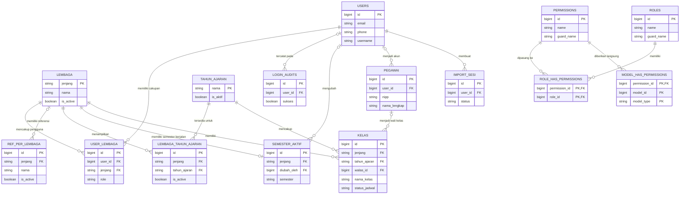
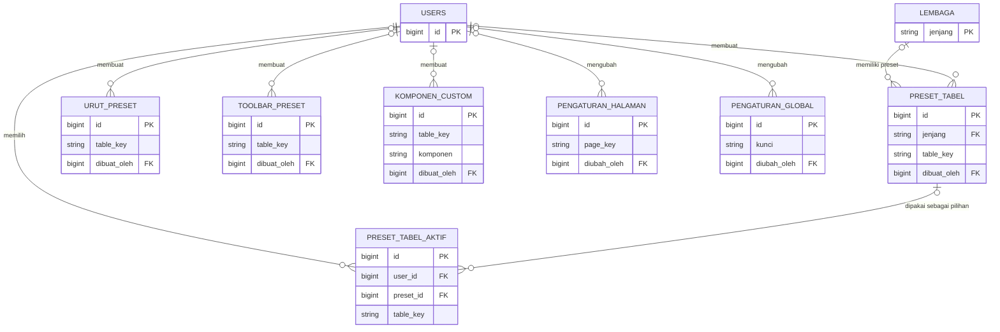
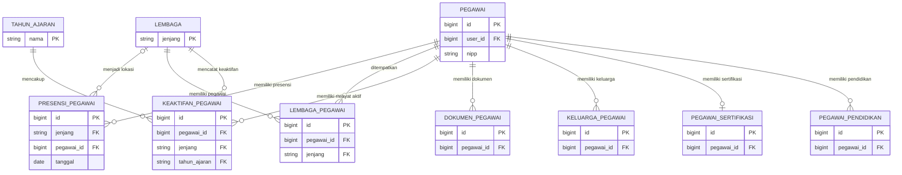
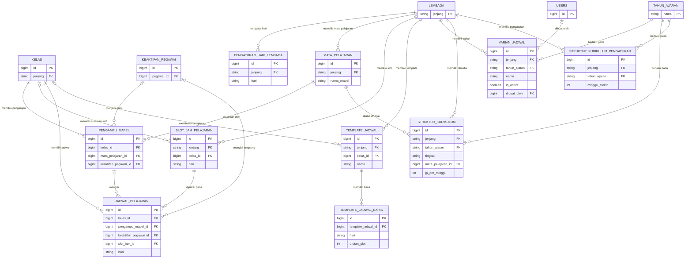
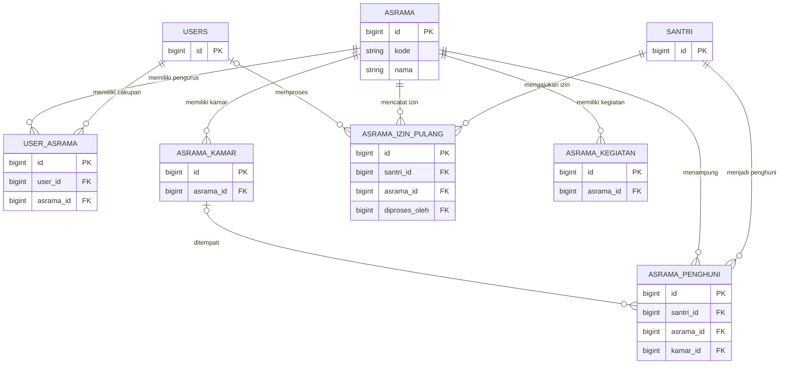
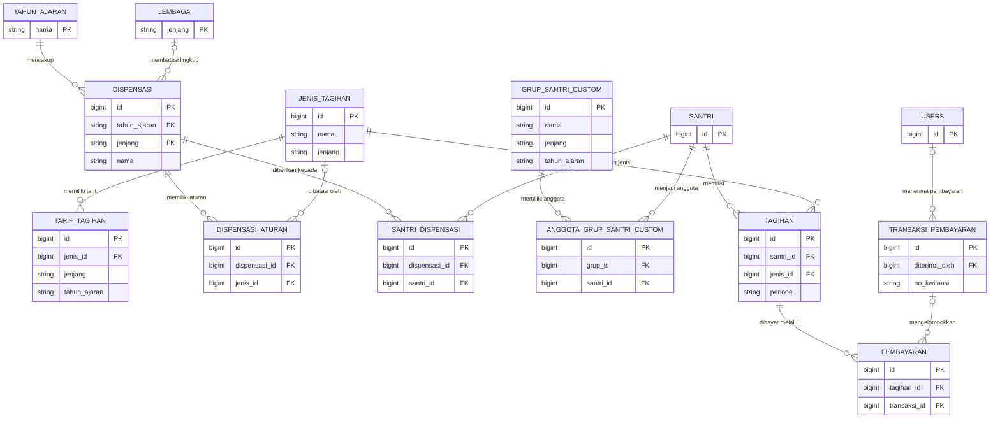

# Diagram Hubungan Entitas (Entity Relationship Diagram/ERD) — SIMPES

Dokumen ini adalah gambaran visual hubungan antartabel yang dirangkum dari
[SCHEMA.md](SCHEMA.md). Rincian kolom, aturan validasi, indeks, nilai bawaan,
dan keputusan rancangan tetap mengikuti `SCHEMA.md`. Jika terdapat perbedaan,
`SCHEMA.md` adalah sumber utama.

Setiap perubahan pada `SCHEMA.md` wajib diikuti pembuatan ulang diagram yang
terdampak di berkas ini dalam pekerjaan dan commit yang sama. Aturan lengkapnya
tercantum pada bagian sinkronisasi skema dan ERD di [`AGENTS.md`](../AGENTS.md).

Diagram dibagi per bidang agar tetap terbaca. Nama kolom yang ditampilkan hanya
kunci utama (Primary Key/PK), kunci asing (Foreign Key/FK), dan beberapa kunci
penting yang membantu memahami hubungan.

Keterangan hubungan:

- `||` berarti tepat satu.
- `o|` berarti nol atau satu.
- `o{` berarti nol atau banyak.
- Tabel `REF_PER_LEMBAGA` adalah ringkasan visual untuk seluruh tabel
  referensi `ref_*` di `SCHEMA.md`, bukan nama tabel fisik.
- Bagian Asrama masih berupa rancangan dan belum dibuat di basis data
  (database/DB), sesuai catatan di `SCHEMA.md`.

## 1. Dasar, pengguna, dan referensi

`REF_PER_LEMBAGA` mewakili tabel eksplisit seperti `ref_agama`,
`ref_cita_cita`, `ref_hobi`, `ref_pekerjaan`, `ref_pendidikan`,
`ref_kebutuhan_khusus`, `ref_kota`, `ref_alamat`, `ref_status_awal`, dan
`ref_status_akhir`, beserta tabel `ref_*` lain yang dicantumkan di
`SCHEMA.md`.

## 2. Santri, riwayat belajar, dan penerimaan santri baru

```mermaid
erDiagram
    USERS {
        bigint id PK
    }
    LEMBAGA {
        string jenjang PK
    }
    TAHUN_AJARAN {
        string nama PK
    }
    KELAS {
        bigint id PK
        string jenjang FK
        string tahun_ajaran FK
        string status_jadwal
    }
    SANTRI {
        bigint id PK
        string nik
        string nisn
        string nama_lengkap
    }
    LEMBAGA_SANTRI {
        bigint id PK
        bigint santri_id FK
        string jenjang FK
        string nis_lokal
    }
    RIWAYAT_BELAJAR {
        bigint id PK
        bigint santri_id FK
        string tahun_ajaran FK
        string jenjang FK
        bigint kelas_id FK
        string semester
    }
    MUTASI_KELUAR {
        bigint id PK
        bigint santri_id FK
        string jenjang FK
        bigint kelas_terakhir_id FK
    }
    ALUMNI {
        bigint id PK
        bigint santri_id FK
        string lembaga_lulus FK
        bigint kelas_lulus_id FK
        string tahun_ajaran_lulus FK
    }
    PSB_KEGIATAN {
        bigint id PK
        string tahun_ajaran FK
        string nama
    }
    PSB_GELOMBANG {
        bigint id PK
        bigint psb_kegiatan_id FK
        string nama
    }
    PSB_KUOTA_BIAYA {
        bigint id PK
        bigint gelombang_id FK
        string jenjang FK
        string tipe_santri
    }
    PSB_CALON_SANTRI {
        bigint id PK
        string jenjang FK
        bigint gelombang_id FK
        string tahun_ajaran FK
        bigint kelas_id FK
        bigint santri_asal_id FK
        bigint santri_id FK
        string no_pendaftaran
    }
    PSB_CALON_LEMBAGA {
        bigint id PK
        bigint psb_calon_santri_id FK
        string jenjang FK
        string peran
    }
    DOKUMEN_SANTRI {
        bigint id PK
        bigint santri_id FK
        bigint psb_calon_santri_id FK
        string lembaga FK
    }
    DOKUMEN_LEMBAGA {
        bigint id PK
        string jenjang FK
    }
    DOKUMEN_WAJIB_LEMBAGA {
        bigint id PK
        bigint psb_kegiatan_id FK
        string jenjang FK
    }
    PSB_LOG_STATUS {
        bigint id PK
        bigint psb_calon_santri_id FK
        bigint oleh_user_id FK
        string ke
    }

    SANTRI ||--o{ LEMBAGA_SANTRI : "terdaftar pada"
    LEMBAGA ||--o{ LEMBAGA_SANTRI : "memiliki santri"
    SANTRI ||--o{ RIWAYAT_BELAJAR : "memiliki riwayat"
    TAHUN_AJARAN ||--o{ RIWAYAT_BELAJAR : "mencakup"
    LEMBAGA ||--o{ RIWAYAT_BELAJAR : "menjadi tempat belajar"
    KELAS o|--o{ RIWAYAT_BELAJAR : "menempatkan"
    SANTRI ||--o{ MUTASI_KELUAR : "memiliki mutasi"
    LEMBAGA ||--o{ MUTASI_KELUAR : "mencatat"
    KELAS o|--o{ MUTASI_KELUAR : "menjadi kelas terakhir"
    SANTRI ||--o{ ALUMNI : "memiliki arsip kelulusan"
    LEMBAGA ||--o{ ALUMNI : "meluluskan"
    KELAS o|--o{ ALUMNI : "menjadi kelas lulus"
    TAHUN_AJARAN ||--o{ ALUMNI : "menjadi tahun lulus"
    TAHUN_AJARAN ||--o| PSB_KEGIATAN : "memiliki kegiatan"
    PSB_KEGIATAN o|--o{ PSB_GELOMBANG : "memiliki"
    PSB_GELOMBANG ||--o{ PSB_KUOTA_BIAYA : "mengatur kuota"
    LEMBAGA ||--o{ PSB_KUOTA_BIAYA : "menerima kuota"
    LEMBAGA ||--o{ PSB_CALON_SANTRI : "menjadi tujuan utama"
    PSB_GELOMBANG o|--o{ PSB_CALON_SANTRI : "menerima pendaftaran"
    TAHUN_AJARAN o|--o{ PSB_CALON_SANTRI : "menjadi tahun masuk"
    KELAS o|--o{ PSB_CALON_SANTRI : "menjadi kelas tujuan"
    SANTRI o|--o{ PSB_CALON_SANTRI : "menjadi santri asal"
    SANTRI o|--o{ PSB_CALON_SANTRI : "menjadi hasil konversi"
    PSB_CALON_SANTRI ||--o{ PSB_CALON_LEMBAGA : "memilih lembaga"
    LEMBAGA ||--o{ PSB_CALON_LEMBAGA : "menjadi pilihan"
    SANTRI o|--o{ DOKUMEN_SANTRI : "memiliki dokumen"
    PSB_CALON_SANTRI o|--o{ DOKUMEN_SANTRI : "mengunggah dokumen"
    LEMBAGA o|--o{ DOKUMEN_SANTRI : "memberi konteks"
    LEMBAGA ||--o{ DOKUMEN_LEMBAGA : "memiliki dokumen"
    PSB_KEGIATAN ||--o{ DOKUMEN_WAJIB_LEMBAGA : "mensyaratkan"
    LEMBAGA ||--o{ DOKUMEN_WAJIB_LEMBAGA : "menerapkan syarat"
    PSB_CALON_SANTRI ||--o{ PSB_LOG_STATUS : "memiliki riwayat status"
    USERS o|--o{ PSB_LOG_STATUS : "mencatat"
```

## 3. Pengaturan tabel dan tampilan

## 4. Pegawai dan penempatan

## 5. Kurikulum dan jadwal

## 6. Penilaian dan rapor

```mermaid
erDiagram
    LEMBAGA {
        string jenjang PK
    }
    TAHUN_AJARAN {
        string nama PK
    }
    SANTRI {
        bigint id PK
    }
    KELAS {
        bigint id PK
    }
    PENGAMPU_MAPEL {
        bigint id PK
    }
    PERISTIWA_NILAI {
        bigint id PK
        string jenjang FK
        string tahun_ajaran FK
        string kode
    }
    KOMPONEN_NILAI {
        bigint id PK
        bigint peristiwa_id FK
        bigint peristiwa_sumber_id FK
    }
    KKM_KEGIATAN {
        bigint id PK
        bigint peristiwa_id FK
    }
    RENTANG_PREDIKAT {
        bigint id PK
        bigint peristiwa_id FK
    }
    NILAI_KOMPONEN {
        bigint id PK
        bigint santri_id FK
        bigint pengampu_mapel_id FK
        string tahun_ajaran FK
        bigint komponen_nilai_id FK
    }
    NILAI_SANTRI {
        bigint id PK
        bigint santri_id FK
        bigint pengampu_mapel_id FK
        string tahun_ajaran FK
        bigint peristiwa_id FK
    }
    RAPOR_CATATAN_WALI {
        bigint id PK
        bigint santri_id FK
        bigint kelas_id FK
        string tahun_ajaran FK
    }
    EKSTRAKURIKULER {
        bigint id PK
        string jenjang FK
        string tahun_ajaran FK
    }
    NILAI_EKSTRAKURIKULER {
        bigint id PK
        bigint santri_id FK
        string tahun_ajaran FK
        bigint ekstrakurikuler_id FK
    }
    PRESTASI_SANTRI {
        bigint id PK
        bigint santri_id FK
        string tahun_ajaran FK
    }
    PREDIKAT_EKSKUL {
        bigint id PK
        string jenjang FK
        string predikat
    }

    LEMBAGA ||--o{ PERISTIWA_NILAI : "memiliki peristiwa"
    TAHUN_AJARAN ||--o{ PERISTIWA_NILAI : "mencakup"
    PERISTIWA_NILAI ||--o{ KOMPONEN_NILAI : "memiliki komponen"
    PERISTIWA_NILAI o|--o{ KOMPONEN_NILAI : "menjadi sumber komponen"
    PERISTIWA_NILAI ||--o{ KKM_KEGIATAN : "memiliki KKM"
    PERISTIWA_NILAI ||--o{ RENTANG_PREDIKAT : "memiliki rentang"
    SANTRI ||--o{ NILAI_KOMPONEN : "memperoleh skor"
    PENGAMPU_MAPEL ||--o{ NILAI_KOMPONEN : "memberi skor"
    TAHUN_AJARAN ||--o{ NILAI_KOMPONEN : "mencakup"
    KOMPONEN_NILAI ||--o{ NILAI_KOMPONEN : "dinilai melalui"
    SANTRI ||--o{ NILAI_SANTRI : "memperoleh nilai akhir"
    PENGAMPU_MAPEL ||--o{ NILAI_SANTRI : "memberi nilai akhir"
    TAHUN_AJARAN ||--o{ NILAI_SANTRI : "mencakup"
    PERISTIWA_NILAI ||--o{ NILAI_SANTRI : "menghasilkan"
    SANTRI ||--o{ RAPOR_CATATAN_WALI : "memiliki catatan rapor"
    KELAS ||--o{ RAPOR_CATATAN_WALI : "memiliki catatan wali"
    TAHUN_AJARAN ||--o{ RAPOR_CATATAN_WALI : "mencakup"
    LEMBAGA ||--o{ EKSTRAKURIKULER : "memiliki kegiatan"
    TAHUN_AJARAN ||--o{ EKSTRAKURIKULER : "mencakup"
    SANTRI ||--o{ NILAI_EKSTRAKURIKULER : "memperoleh nilai"
    TAHUN_AJARAN ||--o{ NILAI_EKSTRAKURIKULER : "mencakup"
    EKSTRAKURIKULER ||--o{ NILAI_EKSTRAKURIKULER : "memiliki peserta"
    SANTRI ||--o{ PRESTASI_SANTRI : "memiliki prestasi"
    TAHUN_AJARAN ||--o{ PRESTASI_SANTRI : "mencakup"
    LEMBAGA o|--o{ PREDIKAT_EKSKUL : "memiliki predikat"
```

## 7. Presensi santri, kedisiplinan, Tahfizh, dan portal wali

```mermaid
erDiagram
    USERS {
        bigint id PK
    }
    LEMBAGA {
        string jenjang PK
    }
    SANTRI {
        bigint id PK
    }
    KELAS {
        bigint id PK
    }
    SESI_PRESENSI {
        bigint id PK
        string jenjang FK
        string nama_sesi
    }
    PRESENSI_SANTRI {
        bigint id PK
        bigint santri_id FK
        bigint kelas_id FK
        bigint sesi_presensi_id FK
        bigint recorded_by FK
    }
    PELANGGARAN_SANTRI {
        bigint id PK
        bigint santri_id FK
        string jenjang FK
        bigint recorded_by FK
    }
    TARGET_TAHFIZ {
        bigint id PK
        string jenjang FK
    }
    SETORAN_TAHFIZ {
        bigint id PK
        bigint santri_id FK
        bigint penguji_id FK
    }
    REKAP_TAHFIZ_SANTRI {
        bigint id PK
        bigint santri_id FK
    }
    WALI_SANTRI_RELASI {
        bigint id PK
        bigint user_id FK
        bigint santri_id FK
    }
    WALI_PORTAL_LOGS {
        bigint id PK
        bigint user_id FK
        bigint santri_id FK
    }
    PENGAJUAN_BIODATA_SANTRI {
        bigint id PK
        bigint santri_id FK
        bigint wali_user_id FK
        bigint diproses_oleh FK
    }

    LEMBAGA o|--o{ SESI_PRESENSI : "memiliki sesi"
    SANTRI ||--o{ PRESENSI_SANTRI : "memiliki presensi"
    KELAS ||--o{ PRESENSI_SANTRI : "mencatat presensi"
    SESI_PRESENSI ||--o{ PRESENSI_SANTRI : "dipakai pada"
    USERS o|--o{ PRESENSI_SANTRI : "mencatat"
    SANTRI ||--o{ PELANGGARAN_SANTRI : "memiliki pelanggaran"
    LEMBAGA o|--o{ PELANGGARAN_SANTRI : "menjadi konteks"
    USERS o|--o{ PELANGGARAN_SANTRI : "mencatat"
    LEMBAGA ||--o{ TARGET_TAHFIZ : "memiliki target"
    SANTRI ||--o{ SETORAN_TAHFIZ : "melakukan setoran"
    USERS o|--o{ SETORAN_TAHFIZ : "menguji"
    SANTRI ||--o| REKAP_TAHFIZ_SANTRI : "memiliki rekap"
    USERS ||--o{ WALI_SANTRI_RELASI : "menjadi wali"
    SANTRI ||--o{ WALI_SANTRI_RELASI : "memiliki wali"
    USERS ||--o{ WALI_PORTAL_LOGS : "mengakses portal"
    SANTRI o|--o{ WALI_PORTAL_LOGS : "diakses datanya"
    SANTRI ||--o{ PENGAJUAN_BIODATA_SANTRI : "diajukan perubahannya"
    USERS ||--o{ PENGAJUAN_BIODATA_SANTRI : "mengajukan sebagai wali"
    USERS o|--o{ PENGAJUAN_BIODATA_SANTRI : "memproses"
```

## 8. Asrama — rancangan, belum diimplementasikan

## 9. Keuangan

Catatan: `jenis_tagihan.jenjang`, `tarif_tagihan.jenjang`,
`tarif_tagihan.tahun_ajaran`, serta lingkup pada `grup_santri_custom` masih
berupa nilai teks tanpa kunci asing (Foreign Key/FK). Karena itu, hubungan
fisiknya tidak digambar sebagai relasi ke `lembaga` atau `tahun_ajaran`.
